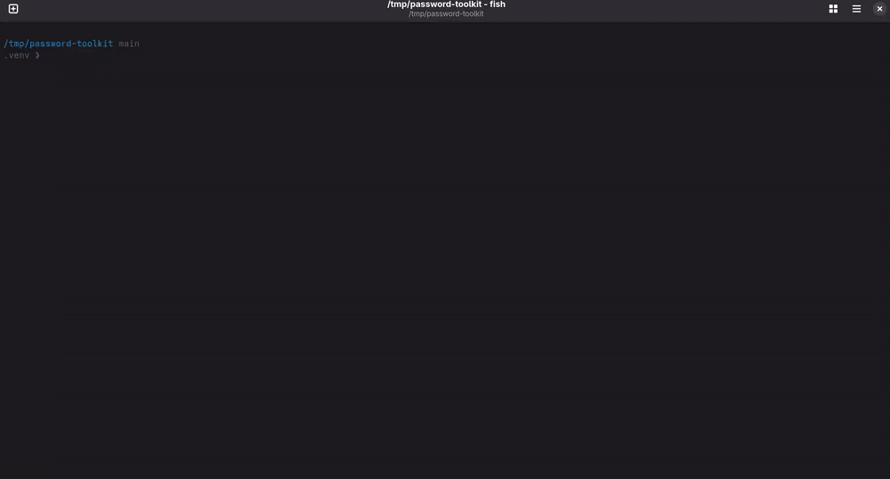

# Password Toolkit

All in one password tool app so that the user can check their password strength (most are weak), see how to strengthen it, encode passwords and also generate passwords automatically.

## Description
- **What problem it solves:** Most people reuse weak or leaked passwords unknowingly. This tool shows how strong a password is, whether it has been leaked, and generates safer ones.
- **Main features:** a terminal app that displays a menu with separate options:
  1. The user inputs a password and the app checks how strong it is from 0-5, and adds suggestions based on what's missing for a secure password.
  2. Generate a password. Creates a random password between 8 and 64 characters using the `secrets` module, and skips confusing characters like 0/O and l/1/I.
  3. Encode / decode. Caesar cipher that shifts letters and digits by a number from 1 to 25, and can shift them back again.
  4. The user inputs a password which is checked using the Have I Been Pwned API. If it has been leaked before, it shows a warning to change it and how many times it has appeared in data breaches. Only the first 5 characters of the password's hash are sent, so the real password never leaves the computer.
  5. View the log. Every check is saved to `log.txt` with a timestamp, so you can look back at past results later. The passwords themselves are never saved, only the results (for example, `[2026-11-20 05:58] Strength check: 4/5 (Strong)`).
- **Who it's for:** anyone who wants to check or improve their passwords from the terminal

## Screenshots


## Installation
```bash
git clone https://github.com/hub0777/password-toolkit.git
cd password-toolkit
python -m venv .venv
source .venv/bin/activate        # fish shell: source .venv/bin/activate.fish
pip install -r requirements.txt
cp .env.example .env
python main.py
```

## Usage
Run `python main.py`, type a number from 1 to 5 to pick an option, and type `exit` to quit. After each option the app returns to the menu.

# Completed functionality and approximate grades from my perception
- **Menu**: returns to the menu after every option and only quits on `exit` (+1)
- **Console design**: coloured output with colorama, ASCII banner shown line by line with a delay, colour-coded strength score (red/yellow/green) in `display.py` (+2)
- **Decomposition into files**: every function is in its own module, `main.py` only calls `run_menu()` (+1)
- **Deployed**: public GitHub repo, anyone can clone and run it with the steps above (+4)
- **Atomic commits on different days**: commits on 16, 17, 20, 25, 26 and 27 November (+2)
- **Deployed on git**: `requirements.txt`, `.gitignore`, `.env.example`, `README.md` (+1)
- **Pull requests**: features built on branches and merged through pull requests (`feature/cipher`, `feature/regex`) (+1)
- **External file**: `log.txt` with timestamps, separate save and view functions in `file_manager.py` (+1)
- **External API**: Have I Been Pwned Pwned Passwords range API in `breach.py` (+1)
- **2 classes**: `Cipher` and `CaesarCipher` in `cipher.py` (+1)
- **Inheritance**: `CaesarCipher` inherits from `Cipher`, reusing its `__init__` and `describe()` and overriding `encode()` and `decode()` (+2)
- **Error handling**: `try/except` with `raise ValueError` for invalid input, `RequestException` for API errors, `FileNotFoundError` for the log, and **regex validation** of number inputs with `re.fullmatch` in `validators.py` (+1)
- **Decomposition principles**: no code outside functions, more than 10 functions, all files under 300 lines and functions under 80 lines, docstrings on every function (+1)
- **In-app interaction**: everything happens inside the app without restarting (+1)
- **Demo GIF**: shows cloning, installing and every menu option running (+2)
- **On-time submission** (+2)
- Data structures used: dictionary (strength ratings), list of tuples (strength checks, menu options), set (skipped characters), lists

**Approximate Total: 24/30 points**

## TODO
### Incomplete Planned Features
- [ ] Decorator, generator and lambda (to complete the data structures criterion)
- [ ] Python `logging` module instead of manual log writing
- [ ] AI explanation of strength results (only the score and tips would be sent, never the password)
- [ ] pytest tests for the strength checker, generator and cipher
- [ ] SQLite database for user profiles and history
- [ ] Web version on GitHub Pages

## Project Structure
```
password-toolkit/
├── .gitignore          # Ignores .env, .venv, log.txt
├── .env.example        # Template for API keys (none needed yet)
├── README.md           # Project description
├── requirements.txt    # Python dependencies (requests, colorama)
├── main.py             # Entry point, only calls run_menu()
├── menu.py             # Menu loop and input validation
├── display.py          # Colours, banner, slow print, menu display
├── strength.py         # Password strength checker
├── generator.py        # Secure password generator
├── cipher.py           # Cipher base class and CaesarCipher
├── breach.py           # Have I Been Pwned breach checker
├── validators.py       # Regex input validation
└── file_manager.py     # Save and view log.txt
```

## Acknowledgments
- [Have I Been Pwned](https://haveibeenpwned.com/API/v3) for the Pwned Passwords API
- W3Schools and GeeksforGeeks for Python references

## Team Members
- GitHub: [@hub0777](https://github.com/hub0777)
